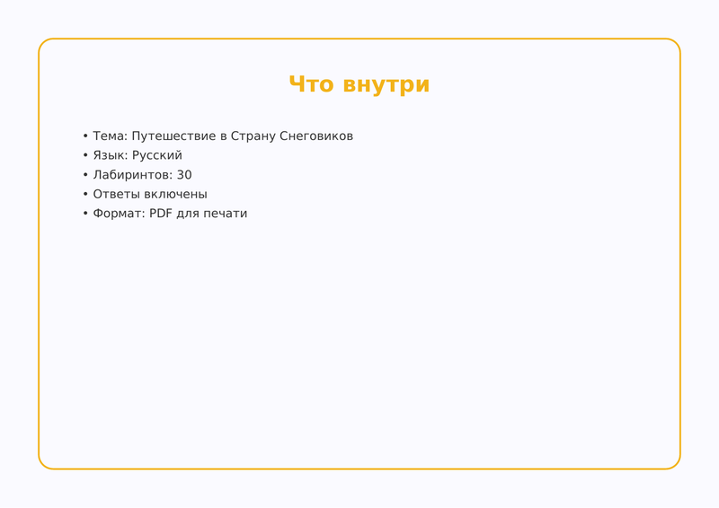
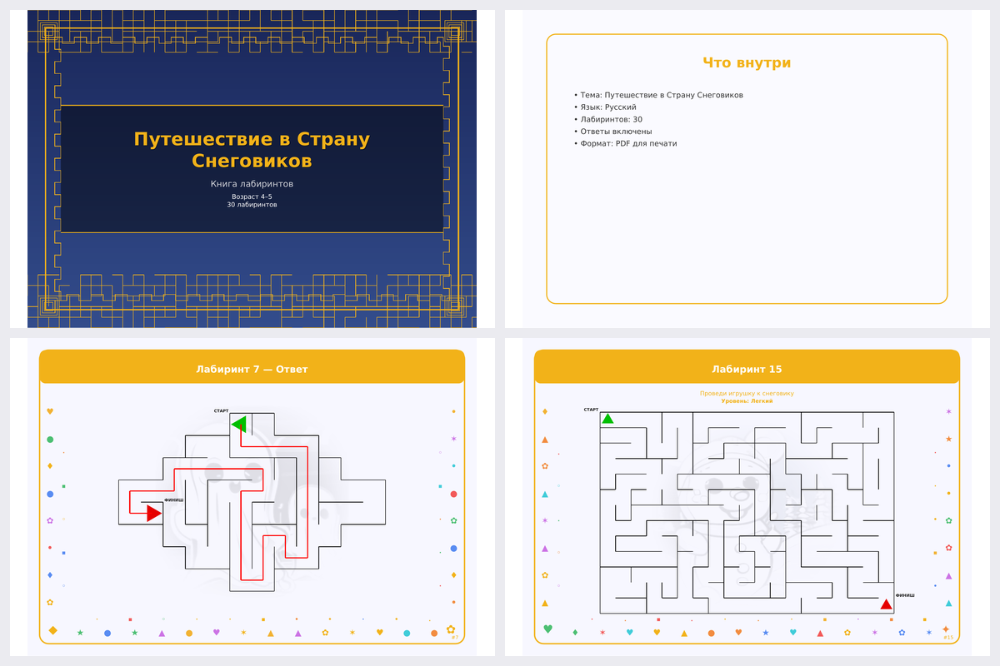

<div align="center">

# Maze Book Generator


**Printable maze books for kids — one command to a publish-ready PDF.**<br/>
Generates complete maze activity books with a cover, task pages, answer pages,
AI-written marketplace copy and AI-drawn illustrations — in English and Russian.


[Features](#-features) •
[How it works](#-how-it-works) •
[Architecture](#-architecture) •
[Getting started](#-getting-started) •
[Configuration](#-configuration--tuning) •
[Examples](#-examples)

</div>

---

## 📖 About

Maze Book Generator turns a single CLI invocation into a print-ready children's
activity book: it picks a theme via OpenAI (or a plain `--theme` flag), draws
unique mazes for every page, renders a full-color PDF plus a print-friendly
black & white variant, generates illustrations through a fallback chain of
image providers, and produces marketing previews and marketplace copy for
KDP-style publishing.

Everything is deterministic: pass `--seed N` and the same book — mazes, layouts,
decorations — comes out byte-identical, which makes regeneration and CI testing
predictable.

## ✨ Features

- **8 maze shapes** — rectangular, square, triangular, circular (true polar
  topology), chaotic, diamond, heart and random-shape masks
- **Difficulty engine** — 7 levels plus page-distribution strategies:
  `FIXED`, `INCREMENTAL`, `RANDOM_RANGE`, `KIDS_EASY`, `CHALLENGE_HARD`,
  `STORY_WAVE`
- **AI theme generation** — OpenAI (`gpt-4o-mini`) produces the title,
  description, per-page task prompts and marketplace keywords; used titles are
  remembered to avoid repeats across batches
- **Illustration fallback chain** — Replicate (cheap SDXL/Flux models) →
  Pollinations → Hugging Face model cascade → local placeholder; missing tokens
  degrade gracefully, never crash the build
- **Full book layout** — cover, contents, intro/outro, maze pages with
  decorations, solutions section, watermark, print-friendly variant
- **Marketplace pack** — `book_into.txt` with SEO-ready title/description plus
  promo images: cover, collage, spread, page previews
- **Bilingual** — EN/RU localization, 11 ready-made config presets
- **Clean architecture** — domain / application / infrastructure layers,
  DI container, all knobs centralized in `settings.py`, seed-reproducible

## 🔄 How it works

| Stage | What happens |
|---|---|
| **1. Theme** | `AIClient` asks OpenAI for a book theme (title, description, page prompts, keywords); `--theme` bypasses this for fully offline runs |
| **2. Spec** | `BookFactory` builds an immutable `BookSpec` — preset + size + pages + difficulty strategy + personalization |
| **3. Mazes** | `MazeGenerator` (seeded `random.Random`) carves one maze per page: DFS carving, mask shapes, loop/shortcut injection by difficulty, BFS-verified solutions |
| **4. Render** | The `pdf/` package draws cover, contents, maze pages and solution pages with ReportLab; a print-friendly variant strips fills and heavy inks |
| **5. Illustrate** | `IllustrationPipeline` walks the provider chain per page prompt and drops PNGs into `illustrations/` |
| **6. Package** | Preview images are rasterized via `pdf2image`; `book_into.txt` with marketplace texts lands next to both PDFs in `output/book_N/` |

## 🏗 Architecture

```text
                        ┌───────────────────────────────────────┐
                        │            CLI (mazebook)             │
                        │   --preset · --seed · --theme · ...   │
                        └───────────────────┬───────────────────┘
                                            │
                        ┌───────────────────▼───────────────────┐
                        │              BookService              │
                        │   batch · page plan · personalization │
                        └───┬───────────────┬───────────────┬───┘
                            │               │               │
              ┌─────────────▼───┐  ┌────────▼───────┐  ┌────▼──────────────┐
              │  MazeGenerator  │  │   PDFRenderer  │  │ IllustrationPipe- │
              │  domain layer   │  │   pdf/ package │  │    line           │
              │  pure, no I/O   │  │   ReportLab    │  │ rep→pol→hf→phold  │
              └────────┬────────┘  └────────┬───────┘  └──────┬────────────┘
                       │                    │                 │
              ┌────────▼────────────────────▼─────────────────▼────────────┐
              │                     output/book_N/                         │
              │   book.pdf · book_print_friendly.pdf · previews · texts    │
              └────────────────────────────────────────────────────────────┘
```

- **Entry point** — [`main.py`](main.py) → [`cli.py`](src/maze_book_generator/cli.py) → composition root [`container.py`](src/maze_book_generator/container.py)
- **`domain/`** — pure maze logic: grid carving, masks, polar topology, BFS solver; zero I/O, fully seed-deterministic
- **`application/`** — `BookService` orchestration, `BookFactory`/`BookSpec`, config presets, illustration pipeline
- **`infrastructure/`** — PDF rendering (`pdf/` subpackage), image providers, theme storage (JSON default, MongoDB optional), OpenAI client, preview generator
- **Constants** — every model name, timeout, rate limit and layout constant lives in [`settings.py`](src/maze_book_generator/settings.py)

## 🧰 Tech stack

| Area | Tools |
|---|---|
| Language / runtime | Python 3.12+, `asyncio` for AI/image calls |
| PDF & images | `reportlab`, `Pillow`, `pdf2image` (poppler) |
| AI | `openai` — `gpt-4o-mini` (themes, marketplace copy) |
| Illustrations | `replicate`, Pollinations API, Hugging Face inference (`httpx`) |
| Config | `pydantic-settings` (`.env`), centralized `settings.py` |
| Storage | JSON file by default; optional MongoDB via `pymongo` |
| Quality | `pytest` + `pytest-asyncio` + `pytest-cov` (82%), Ruff, Pylint, Pyright, Semgrep, import-linter |
| Packaging | `hatchling`, console script `mazebook` |

## 📁 Project structure

```text
.
├── main.py                              # thin shim → cli.main()
├── src/maze_book_generator/
│   ├── cli.py                           # argparse CLI (mazebook generate ...)
│   ├── container.py                     # DI composition root
│   ├── settings.py                      # ALL constants & configuration
│   ├── localization.py                  # EN/RU texts
│   ├── domain/
│   │   ├── maze/                        # grid, masks, carving, solver, polar
│   │   └── models.py                    # Book, BookPage, Theme, Difficulty, ...
│   ├── application/
│   │   ├── book_service.py              # generation orchestration
│   │   ├── book_factory.py              # BookSpec + page assembly
│   │   ├── illustration_pipeline.py     # provider fallback chain
│   │   └── config_presets.py            # 11 ready-made BookConfig presets
│   └── infrastructure/
│       ├── pdf/                         # renderer, pages, decorations, drawing/
│       ├── images/                      # replicate / pollinations / hf / placeholder
│       ├── storage/                     # ThemeRepository (JSON | MongoDB)
│       ├── ai_client.py                 # OpenAI theme client
│       └── preview_generator.py         # marketing previews via pdf2image
├── tests/                               # pytest suite (195 tests)
├── static/                              # example images used in this README
├── output/                              # generated books (gitignored)
└── .env.example                         # template for API credentials
```

## 🚀 Getting started

### Prerequisites

- **Python 3.12+**
- **DejaVu fonts** — required for PDF text (Cyrillic support).
  Linux: `sudo apt install fonts-dejavu` · macOS: `brew install --cask font-dejavu`
- **poppler** — only for preview PNGs (`--no-previews` disables).
  Linux: `sudo apt install poppler-utils` · macOS: `brew install poppler`

### Installation

```bash
git clone <your-repo-url>
cd MazeBookGenerator

uv sync                              # recommended
# or: pip install -e .

pip install -e ".[mongodb]"          # optional: MongoDB theme storage
cp .env.example .env                 # then fill in API keys (all optional)
```

### Environment variables

All keys are **optional** — without image tokens the provider chain degrades to
a local placeholder, and without `OPEN_AI_KEY` the `--theme` flag supplies the
theme offline:

| Variable | Description |
|---|---|
| `OPEN_AI_KEY` | OpenAI API key — theme & marketplace copy generation |
| `REPLICATE_API_TOKEN` | Replicate — primary illustration provider |
| `HF_TOKEN` | Hugging Face — fallback illustration provider |
| `MONGODB_ENABLED` | `true` to store used themes in MongoDB instead of JSON |
| `MONGODB_URI` | MongoDB connection string (default `mongodb://localhost:27017`) |

### Run

```bash
# One book with defaults (preset ru_kids_easy)
mazebook generate

# Batch of books with a preset and difficulty strategy
mazebook generate --books 3 --pages 20 --size 17x13 \
    --preset en_school --difficulty INCREMENTAL

# Reproducible PDF-only run (no illustrations/previews)
mazebook generate --seed 42 --no-images --no-previews

# Fully offline — no OpenAI key needed
mazebook generate --theme "Maze Adventures" --no-images

# Personalized cover
mazebook generate --child-name Emma --child-age 6

# Equivalent entry points
python -m maze_book_generator generate --preset ru_kids_easy
python main.py generate
```

| Flag | Default | Purpose |
|---|---|---|
| `--books` | 1 | Books per batch |
| `--pages` | 30 | Mazes per book |
| `--size` | 15x11 | Maze grid `WxH` |
| `--preset` | ru_kids_easy | `BookConfig` preset |
| `--difficulty` | KIDS_EASY | Difficulty strategy |
| `--seed` | — | Base seed for reproducibility |
| `--theme` | — | Theme title without OpenAI (offline) |
| `--child-name` / `--child-age` | — | Cover personalization |
| `--no-images` | — | Skip illustrations |
| `--no-previews` | — | Skip preview PNGs |
| `--no-print-friendly` | — | Skip the B&W PDF variant |

Output lands in `output/book_N/`: `book.pdf` + `book_print_friendly.pdf`,
`illustrations/`, preview PNGs and `book_into.txt` with marketplace texts.

## ⚙️ Configuration & tuning

- **Presets** — `en_kids_basic`, `en_kids_printable`, `en_school`,
  `en_school_printable`, `en_challenge`, `ru_kids_easy`, `ru_kids_basic`,
  `ru_kids_printable`, `ru_school`, `ru_school_printable`, `ru_challenge`
  ([`config_presets.py`](src/maze_book_generator/application/config_presets.py))
- **All knobs** — model names and fallback lists, HTTP timeouts, rate-limit
  delays, layout constants, prompt templates — are centralized in
  [`settings.py`](src/maze_book_generator/settings.py); keep them there rather
  than scattering magic numbers

## 🖼 Examples

A generated book (preset `en_kids_basic`, 20 pages):

| Cover | Spread | Maze page |
|-------|--------|-----------|
|  |  |  |

| Preview collage | Promo banner | AI illustration |
|-----------------|--------------|-----------------|
|  |  |  |

## 🗺 Roadmap / known limitations

- Illustration quality depends on free-tier providers; chain order is tuned
  for cost, not fidelity
- MongoDB storage is opt-in (`.[mongodb]` + `MONGODB_ENABLED=true`); JSON
  storage is the zero-infra default
- `book_into.txt` keeps its historical marketplace filename

## 🤝 Contributing

Issues and pull requests are welcome. Keep the layered architecture intact
(domain stays I/O-free), run `pytest --cov=maze_book_generator` (≥80%) and the
quality gate before submitting.

## 📄 License

This project is licensed under the **GNU General Public License v3.0
(GPL-3.0)** — see [LICENSE](LICENSE).

You may use, modify and distribute the code for any purpose, including
commercially. Any modified version you distribute must be published under the
same license with its source code.

## 🙏 Acknowledgments

Illustration APIs by [Replicate](https://replicate.com/),
[Pollinations](https://pollinations.ai/) and
[Hugging Face](https://huggingface.co/). Themes powered by OpenAI.
PDF built with [ReportLab](https://www.reportlab.com/), fonts by
[DejaVu](https://dejavu-fonts.github.io/).
